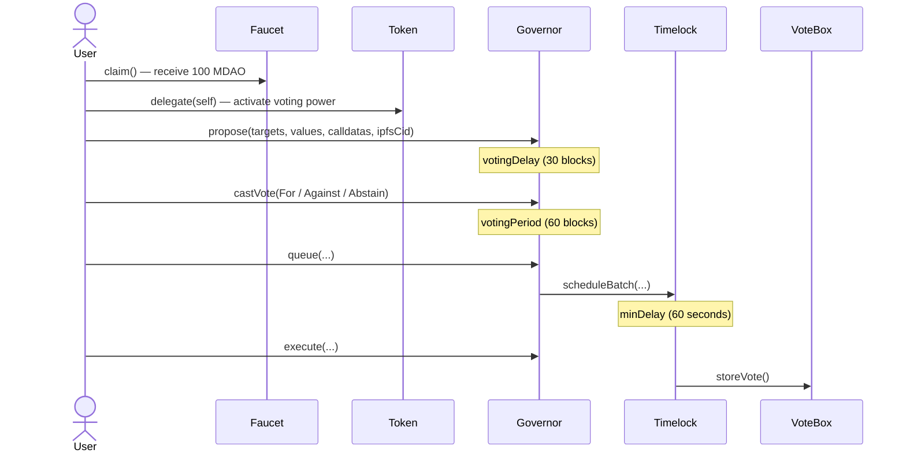

# What I Learned Building a Mini DAO

> **The short version:** OpenZeppelin Governor does about 90% of the work for you, but three things about it ran against my intuition: its time units, where voting power comes from, and which function an override actually affects. I only understood them after reading the source.

- Written: 2026-11-10
- Versions: Solidity `^0.8.27`, OpenZeppelin Contracts `5.6.1`, Foundry `forge 1.5.1`
- Source: [github.com/VxxxxC/mini_dao](https://github.com/VxxxxC/mini_dao)
- Live demo (Sepolia testnet): [mini-dao.netlify.app](https://mini-dao.netlify.app)

> A note up front: this is a self-learning project for Solidity and DAO governance. It is deployed only on the Sepolia testnet, holds no real money, and governs nothing real. What follows is a record of the mistakes I made, not production best practice.

---

## Contents

1. [What a DAO actually is: five contracts, five roles](#1-what-a-dao-actually-is-five-contracts-five-roles)
2. [Concept 1: holding tokens is not the same as having votes](#2-concept-1-holding-tokens-is-not-the-same-as-having-votes)
3. [Concept 2: how snapshots stop flash-loan voting](#3-concept-2-how-snapshots-stop-flash-loan-voting)
4. [Concept 3: the timelock and the hand-over of power](#4-concept-3-the-timelock-and-the-hand-over-of-power)
5. [Pitfall 1: `30 seconds` actually means 30 blocks](#5-pitfall-1-30-seconds-actually-means-30-blocks)
6. [Pitfall 2: I overrode `getVotes()` and voting didn't change at all](#6-pitfall-2-i-overrode-getvotes-and-voting-didnt-change-at-all)
7. [Pitfall 3: on-chain is permanent, off-chain is not](#7-pitfall-3-on-chain-is-permanent-off-chain-is-not)
8. [Testing: 143 passing tests that still missed a bug](#8-testing-143-passing-tests-that-still-missed-a-bug)
9. [Known issues and limitations](#9-known-issues-and-limitations)
10. [What I would do differently](#10-what-i-would-do-differently)
11. [References](#11-references)

---

## 1. What a DAO actually is: five contracts, five roles

Before I started, I pictured a DAO as "a contract with a vote function in it". A DAO built on OpenZeppelin is really several contracts, each doing one job:

| Contract | Role | In one sentence |
| --- | --- | --- |
| `MiniDaoToken` | Ballots | ERC20 + `ERC20Votes`; holdings become voting power (only after delegation, see section 2) |
| `MiniDaoFaucet` | Ballot distribution | Each wallet can claim 100 MDAO once |
| `MiniDaoGovernance` | Parliament | Accepts proposals, counts votes, decides pass or fail |
| `MiniDaoTimeLock` | Treasury + executor | Passed proposals wait here for a delay before they can run; also holds 70% of the token supply as the treasury |
| `MiniDaoVoteBox` | The thing being governed | A simple counter; only the Timelock may call `storeVote()` |

The full flow looks like this:



The most useful mental model I came away with: **the Governor never executes anything itself.** It only decides whether a proposal is allowed. The Timelock is what actually calls the target contract, which is why the VoteBox is owned by the Timelock and not by the Governor.

A proposal's life is a state machine. The `ProposalState` enum in OpenZeppelin 5.x:

| Value | State | Meaning |
| --- | --- | --- |
| 0 | Pending | Submitted, voting has not started (inside `votingDelay`) |
| 1 | Active | Voting is open |
| 2 | Canceled | Cancelled |
| 3 | Defeated | Quorum not reached, or more Against than For |
| 4 | Succeeded | Passed, can be queued |
| 5 | Queued | Waiting in the Timelock |
| 6 | Expired | Queued but never executed in time |
| 7 | Executed | Done |

Every proposal card on the frontend reads `state(proposalId)` and uses that number to decide whether to show the vote buttons, the Queue button or the Execute button.

---

## 2. Concept 1: holding tokens is not the same as having votes

The first time I tested end to end, I claimed 100 MDAO from the faucet, went to vote, and my vote weight was **0**.

`ERC20Votes` does not treat your balance as voting power automatically. You first have to `delegate` (to yourself is fine), and only then does it start recording voting-power checkpoints for you. OpenZeppelin designs it this way to save gas: holders who never take part in governance don't pay for extra checkpoint writes on every transfer.

So the faucet page ends up sending two transactions:

```ts
// src/routes/faucet/+page.svelte (excerpt; error handling and UI state omitted)
const claimTx = await writeContract(wagmiConfig, {
	address: Address.FAUCET,
	abi: MiniDaoFaucet.abi,
	functionName: 'claim',
	chainId: chainId
});
await waitForTransactionReceipt(wagmiConfig, { hash: claimTx });

const delegateTx = await writeContract(wagmiConfig, {
	address: Address.TOKEN,
	abi: MiniDaoToken.abi,
	functionName: 'delegate',
	args: [address], // the user's own wallet address: delegate to self
	chainId: chainId
});
await waitForTransactionReceipt(wagmiConfig, { hash: delegateTx });
```

Why not delegate on the user's behalf inside `claim()`? Because `delegate()` uses `msg.sender` to decide who is delegating. If the faucet contract calls it, the faucet delegates its own tokens, not the user's. Delegating for someone else requires `delegateBySig` (the user signs, anyone submits). I went with the simplest option: ask the user to sign twice.

> **Lesson:** in a governance token, "balance" and "voting power" are two separate numbers. The first does not turn into the second by itself.

---

## 3. Concept 2: how snapshots stop flash-loan voting

If voting power were based on the balance *right now*, an attacker could borrow a large amount of tokens at the moment of voting (a flash loan), vote, and repay.

The Governor avoids this by giving every proposal a `proposalSnapshot`. Votes are weighted by **voting power at the snapshot timepoint**, not current balance:

```solidity
// lib/openzeppelin-contracts/contracts/governance/Governor.sol (v5.6.1, line 636)
uint256 totalWeight = _getVotes(account, proposalSnapshot(proposalId), params);

// lib/openzeppelin-contracts/contracts/governance/extensions/GovernorVotes.sol
function _getVotes(address account, uint256 timepoint, bytes memory)
    internal view virtual override returns (uint256)
{
    return token().getPastVotes(account, timepoint);
}
```

I wrote a security test to prove it. After the snapshot, the Timelock transfers 10 million MDAO to an attacker, who immediately delegates and votes:

```solidity
// contracts/test/security/MiniDaoSecurityTest.t.sol (excerpt)
_passVotingDelay(); // block.number is now past the snapshot

vm.prank(address(timelock));
token.transfer(ATTACKER, 10_000_000 * 10 ** 18);
vm.prank(ATTACKER);
token.delegate(ATTACKER);

vm.prank(ATTACKER);
governance.castVote(pid, 1); // does not revert, but the weight is 0
```

The transaction does not revert. The attacker's voting power at the snapshot was 0, so the vote counts for nothing. I found this counter-intuitive: **the attack is not blocked, it is made worthless.** If you only write `expectRevert`, you will conclude the protection doesn't work.

This also explains why `votingDelay` exists. After a proposal is submitted there is a waiting period before voting opens, so people have time to read it and delegate, and the snapshot is taken at the end of that delay.

---

## 4. Concept 3: the timelock and the hand-over of power

`TimelockController` uses role-based access control. The roles that matter:

| Role | Granted to (in this project) | Meaning |
| --- | --- | --- |
| `PROPOSER_ROLE` | Governor | Only the Governor can queue proposals in the Timelock |
| `CANCELLER_ROLE` | Governor | Only the Governor can cancel queued proposals |
| `EXECUTOR_ROLE` | `address(0)` | *Anyone* can trigger execution once the delay has passed |
| `DEFAULT_ADMIN_ROLE` | The Timelock itself | Timelock settings can only change through governance |

The last few lines of the deploy script are where decentralisation actually happens:

```solidity
// contracts/script/DeployDao.s.sol (excerpt)
timelock.grantRole(timelock.PROPOSER_ROLE(), address(governance));
timelock.grantRole(timelock.CANCELLER_ROLE(), address(governance));
timelock.grantRole(timelock.EXECUTOR_ROLE(), address(0));

timelock.grantRole(timelock.DEFAULT_ADMIN_ROLE(), address(timelock));
timelock.revokeRole(timelock.DEFAULT_ADMIN_ROLE(), deployer); // hand over the last key

MiniDaoVoteBox voteBox = new MiniDaoVoteBox();
voteBox.transferOwnership(address(timelock));
```

Two things I learned here.

**First, decentralisation is not a property of a contract. It is a step in the deployment.** With the exact same `MiniDaoTimeLock.sol`, forgetting the `revokeRole` line would leave the deployer able to bypass voting and `schedule()` anything directly. So I added an invariant test, `invariant_DeployerHasNoAdminRole`, and a security test, `testSecurity_AccessControl_DeployerCannotScheduleAfterAdminRoleRevoked`, to check exactly that.

**Second, deployment order is dictated by constructor arguments.** The Token constructor needs the treasury address (70% of supply is minted to the Timelock), so the order has to be Timelock → Token → Faucet → Governor → VoteBox.

(Later, reading the OpenZeppelin 5.6.1 source, I found that the `TimelockController` constructor already calls `_grantRole(DEFAULT_ADMIN_ROLE, address(this))`. The line in my script granting admin to the Timelock is redundant. Harmless, but it shows I was following a tutorial rather than reading the source.)

---

## 5. Pitfall 1: `30 seconds` actually means 30 blocks

This bug cost me more time than anything else in the project. From implementing the first countdown timer on 2026-04-09 to merging the last fix on 2026-04-30, 13 commits mention countdown, timer or blocktime in their message.

I originally wrote:

```solidity
// contracts/src/MiniDaoGovernance.sol
function votingDelay() public pure override returns (uint256) {
    return 30 seconds; // I thought this meant 30 seconds
}

function votingPeriod() public pure override returns (uint256) {
    return 1 minutes; // I thought this meant 1 minute
}
```

In Solidity, `30 seconds` is just a number literal equal to `30`, and `1 minutes` equals `60`. The compiler has no idea what unit you mean; it just multiplies.

How the Governor interprets that number depends on its `clock()` ([ERC-6372](https://eips.ethereum.org/EIPS/eip-6372)). `GovernorVotes` follows the token's clock, and `ERC20Votes` uses block numbers by default:

```solidity
// lib/openzeppelin-contracts/contracts/governance/utils/Votes.sol (v5.6.1)
function clock() public view virtual returns (uint48) {
    return Time.blockNumber();
}
```

So `votingDelay = 30` means **30 blocks**, and the wall-clock time depends on the chain:

| Environment | Block time | `votingDelay` (30 blocks) | `votingPeriod` (60 blocks) |
| --- | --- | --- | --- |
| Anvil `--block-time 2` | 2 s | ~1 minute | ~2 minutes |
| Sepolia | ~12 s | ~6 minutes | ~12 minutes |
| Anvil default | a block only when a tx arrives | no fixed time | no fixed time |

Worse, **one flow uses two different clocks**:

- The Governor's `votingDelay` / `votingPeriod` count **block numbers**
- The Timelock's `minDelay` counts **`block.timestamp` (seconds)**

So the frontend countdown needs two separate pieces of logic. Pending and Active countdowns estimate time by multiplying block counts by 12 seconds. The Queued countdown compares the Timelock ETA (in seconds) with on-chain time. I started with the browser's `Date.now()`, but local time and chain time don't necessarily agree, so I switched to reading the latest block's `timestamp` with `getBlock()`:

```ts
// src/lib/components/ProposalCard.svelte (excerpt)
const block = await getBlock(wagmiConfig, { blockTag: 'latest' });
const blockTime = Number(block.timestamp) * 1000;
```

The git history records how I got there:

- `9d0860f`: discovered I could get on-chain time from `getBlock()`
- `7ad7426`: changed the timer interval from 1.5 s to 12 s (Anvil and Sepolia block times differ)
- `e32c660`: added `countdownEndVoting()` to the contract so the frontend no longer has to estimate

> **Lesson:** in Solidity, time-unit suffixes are multiplication, not types. Whenever you see a "time" parameter, find out whether its clock is blocks or seconds.

One more caveat: Sepolia does not produce a block in every slot, so "12 seconds per block" is an estimate. The countdown on screen can drift slightly from reality. When it reaches 0, the frontend re-reads `state()` from the chain instead of trusting its own arithmetic.

---

## 6. Pitfall 2: I overrode `getVotes()` and voting didn't change at all

I wanted one person, one vote: anyone holding at least 10 MDAO gets exactly 1 vote, regardless of how many tokens they hold. So I overrode `getVotes`:

```solidity
// contracts/src/MiniDaoGovernance.sol
function getVotes(address account, uint256 blockNumber)
    public view override(Governor) returns (uint256)
{
    uint256 actualTokenVotes = super.getVotes(account, blockNumber);
    if (actualTokenVotes >= 10 * 10 ** 18) {
        return 1;
    } else {
        return 0;
    }
}
```

It compiled, the tests passed, and vote counting never used it.

Look back at the source in section 3: `_castVote` calls the **internal `_getVotes`**, not the public `getVotes`. The public `getVotes` is just a view function for external readers, and it calls `_getVotes` too. I overrode a read-only exit; vote counting goes down a different path:

```
castVote()
  └─ _castVote()
       └─ _getVotes()          ← vote counting uses this
            └─ token.getPastVotes()

getVotes()                      ← I overrode this, but counting never goes through it
  └─ _getVotes()
```

The result: vote weight is still the token amount (1 MDAO = 1e18 weight), and a quorum of 300e18 means 300 MDAO of For + Abstain votes. Because every user claims exactly 100 MDAO, "three people must vote to reach quorum" looks exactly like what I intended, and I didn't notice the override was dead for a long time.

The frontend shows the same thing. In `FetchProposals.svelte.ts` I divide the `proposalVotes` result by 100 so the UI shows "1 vote" instead of "100":

```ts
// src/lib/components/FetchProposals.svelte.ts
// NOTE: formatEther converts bigint (wei) → string (ether); divide by 100 → 1 token = 1 voting weight
totalVotes: Number(formatEther(againstVotes + forVotes + abstainVotes)) / 100,
```

That is the frontend papering over a contract problem. Anyone who gets extra MDAO through some route other than the faucet will have more than "1 vote".

**What would a correct implementation look like?** I think it means overriding the internal `_getVotes` and also changing `quorum()` to count votes (for example `3`), because `_quorumReached` compares `forVotes + abstainVotes` directly against `quorum()`. I haven't written tests for that change, so treat it as a hypothesis.

> **Lesson:** overriding a public function does not change the behaviour behind it. Before customising an OpenZeppelin extension, trace which function actually gets called.

---

## 7. Pitfall 3: on-chain is permanent, off-chain is not

Proposal titles and bodies are too long to store on-chain cheaply. My approach:

1. The frontend asks the user to sign a message with their wallet: `Create proposal [title] at timestamp`
2. A SvelteKit API route (`/api/create_proposal`) verifies the signature, checks it is less than 5 minutes old, and checks the wallet holds at least 0.001 ETH
3. If everything passes, it uploads the JSON to Filebase (S3-compatible, backed by IPFS) and reads the CID from the `x-amz-meta-cid` response header
4. The frontend calls `governor.propose(..., description = ipfsCid)`, writing the CID on-chain as the description

Reading goes the other way: read `ProposalCreated` events → take the description (the CID) → fetch the content from an IPFS gateway.

There was a problem with this design I didn't see at the time: **the on-chain record is there forever, but files in a Filebase bucket can be deleted.** I once cleaned up the bucket, and afterwards the proposal list no longer matched: the events were still on-chain, but the CIDs no longer resolved, and every card showed "⚠️ Failed to load proposal title".

My eventual fix (commit `3e216f1`) was to deploy a fresh set of contracts, empty Filebase and start over from zero. In other words, a problem in off-chain storage ended up being solved by redeploying every on-chain contract.

A related pitfall was reading events. `getContractEvents` originally used `fromBlock: 0n`, but free RPC providers limit the block range for `eth_getLogs`, and the request failed (commit `c69878a`). The fix was to set `fromBlock` to the block where the Governor was deployed and to switch to a free RPC with looser limits (`07609ef`). The cost: every redeploy means updating that number by hand.

> **Lesson:** a system is only as decentralised as its most centralised component. If the content lives in a bucket you can delete, the proposal is only as permanent as that bucket.

---

## 8. Testing: 143 passing tests that still missed a bug

The contract tests are split into five layers, each checking something different:

| Type | Location | Checks | Examples |
| --- | --- | --- | --- |
| Unit | `test/unit/` | Happy and error paths of each function | `testCannotVoteTwice`, `testRevertFaucetEmpty_ZeroBalance` |
| Fuzz | `test/fuzz/` | Properties under random input | `testFuzz_TimelockRevertsBeforeDelay` |
| Integration | `test/integration/` | The whole flow from claim to execute | |
| Invariant | `test/invariant/` | Conditions that hold after any random call sequence | `invariant_TotalSupplyIsConstant`, `invariant_VoteBoxOwnerIsTimelock` |
| Security | `test/security/` | Attack scenarios | Reentrancy, flash loan, deployer privilege |

Settings in `foundry.toml`: 1,000 fuzz runs (fixed seed `0xdeadbeef` for reproducibility), invariant 256 runs × depth 128, `fail_on_revert = true`.

Result on my machine on 2026-11-10 with `forge 1.5.1`:

```
$ forge test --offline
Ran 9 test suites in 3.06s (14.80s CPU time): 143 tests passed, 0 failed, 0 skipped (143 total tests)
```

The test I learned the most from was the reentrancy test. `MiniDaoFaucet.claim()` follows Checks-Effects-Interactions: it sets `hasClaimedFaucet[msg.sender] = true` before calling `transfer`. MDAO is a plain ERC20 whose transfer makes no callback, so I used a mock token (`MockCallbackToken`) that imitates hook-style tokens such as ERC777 / ERC1363 and re-enters `claim()` mid-transfer. The test shows the attacker still receives only one payout.

**But with all 143 tests passing, the `getVotes` problem from section 6 still got through.** I had this fuzz test:

```solidity
// contracts/test/fuzz/MiniDaoFuzzTest.t.sol (excerpt)
uint256 votes = governance.getVotes(holder, block.number - 1);
if (rawTokens >= 10e18) {
    assertEq(votes, 1, "should have 1 vote unit with >= 10 tokens");
} else {
    assertEq(votes, 0, "should have 0 vote units with < 10 tokens");
}
```

It correctly proves that "`getVotes()` returns 0 or 1". It does not prove that "a vote is weighted 0 or 1". The test checked the function I wrote, not the behaviour I wanted. Had I asserted `forVotes == 1` in `proposalVotes` after a `castVote`, it should have failed, because `forVotes` comes back as `100e18` for a 100 MDAO holder.

> **Lesson:** assert the outcome you care about ("how much is this vote worth"), not the implementation you wrote ("what does this function return").

---

## 9. Known issues and limitations

Things I know about and haven't fixed. If you use this project as a reference, keep them in mind:

- **One person, one vote does not work.** See section 6. Voting is token-weighted.
- **Quorum is hard-coded at 300 MDAO.** Total supply is 1 billion, so quorum is 0.00003% of supply. A production DAO should use `GovernorVotesQuorumFraction` to set quorum as a percentage of supply.
- **Demo parameters are extremely short.** Voting delay 30 blocks, voting period 60 blocks, timelock 60 seconds. Real DAOs use days and weeks so the community has time to react.
- **There is no on-chain proposal threshold.** `proposalThreshold()` is left at the default of 0, so anyone, even with no MDAO, can call `propose()` directly. The signature and ETH-balance checks in the API only filter proposals submitted through my frontend; calling the contract directly skips them.
- **The anti-spam check looks at ETH, not MDAO.** The API checks for at least 0.001 ETH, which has nothing to do with governance rights.
- **Signatures can be replayed for 5 minutes.** The signed message only contains the title and a timestamp, with no nonce, so the same signature can be resubmitted while it is valid.
- **The `proposerAddress` stored on IPFS can differ from the address that actually called `propose()` on-chain.** The frontend displays the IPFS version.
- **A production contract imports `forge-std/console.sol`.** `MiniDaoVoteBox.storeVote()` calls `console.log`, which does nothing useful on a real network and still costs gas. It should be removed before deploying.
- **The convenience overload `propose(address target)` is not used by the frontend** and is dead code.

---

## 10. What I would do differently

My own judgement, not verified conclusions:

1. **Decide blocks or timestamps on day one.** OpenZeppelin 5 lets you switch the token's `clock()` to `block.timestamp` (with a matching `CLOCK_MODE()`). With seconds everywhere, the frontend countdown would be much simpler.
2. **Read the source before copying the tutorial.** The redundant `grantRole` in section 4 and the `getVotes` override in section 6 both came from adapting examples without tracing which functions OpenZeppelin calls internally.
3. **Write integration tests for behaviour.** Especially for any governance rule I override: assert the result inside a full propose → vote → tally flow.
4. **Store a hash of off-chain content on-chain.** Even if the content disappears, you can prove what it was, and re-upload the same file to another pinning service.
5. **Move `fromBlock` and contract addresses into config / env** instead of hard-coding them in components, so a redeploy doesn't leave stale values behind.

---

## 11. References

- OpenZeppelin Contracts 5.x — Governance guide: <https://docs.openzeppelin.com/contracts/5.x/governance>
- OpenZeppelin Contracts 5.x — Governance API (Governor, TimelockController, GovernorVotes): <https://docs.openzeppelin.com/contracts/5.x/api/governance>
- ERC-6372: Contract clock: <https://eips.ethereum.org/EIPS/eip-6372>
- ERC-5805: Voting with delegation: <https://eips.ethereum.org/EIPS/eip-5805>
- Foundry Book — fuzz and invariant testing: <https://book.getfoundry.sh/forge/fuzz-testing>, <https://book.getfoundry.sh/forge/invariant-testing>
- Solidity docs — time units: <https://docs.soliditylang.org/en/latest/units-and-global-variables.html#time-units>
- Project source: <https://github.com/VxxxxC/mini_dao>
